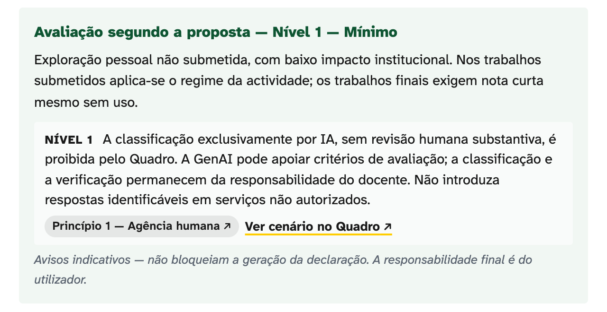
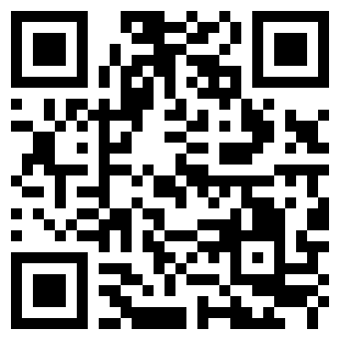
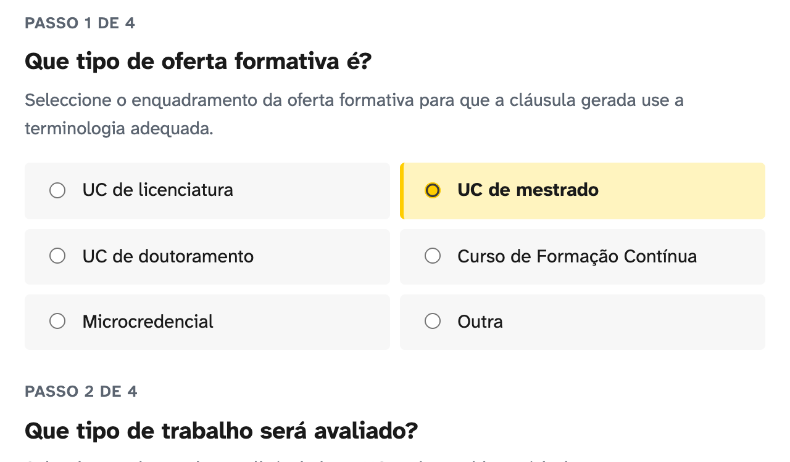

## Regras sobre IA ainda são raras no ensino superior

::: {.columns}
::: {.column width="42%"}
[14,7 %]{.stat}

::: {.stat-caption}
das 68 instituições de ensino superior inquiridas têm políticas sobre IA em prática (CNIPES, 2026).
:::
:::
::: {.column width="58%"}
::: {.lead}
- Inquéritos internacionais a estudantes de medicina documentam o uso de IA generativa.
- Na FMUP, ainda não medimos o uso nem as regras de cada unidade curricular.
- O piloto começa por medir.
:::
:::
:::

::: {.notes}
Antes de começar (15 s): apresento-me e digo o estado do trabalho. É um contributo individual, não é política da Faculdade.

1 min. Começo pelo problema: a IA generativa já é usada e poucas instituições têm regras em prática. Sou claro sobre o limite: o número é sobre instituições, não sobre a FMUP. Não temos inquérito local. Por isso o piloto começa por medir, por exemplo quantas UCs já têm cláusula sobre IA. Fonte: diagnóstico CNIPES, Abril de 2026. Os inquéritos a estudantes de medicina estão citados no Quadro (Tran 2025, Alkhaaldi 2023). O EU AI Act, a Agenda Nacional de IA e o CNE já fixaram prazos e recomendações: alto risco em Dezembro de 2027 e Agosto de 2028.
:::

## Três peças, publicadas e gratuitas

::: {.columns}
::: {.column width="33%"}
::: {.card}
<h3>Quadro</h3>

Documento de referência para o uso de IA generativa na FMUP.

Duas partes e doze anexos.
:::
:::
::: {.column width="33%"}
::: {.card}
<h3>Themis</h3>

Ferramenta web que gera declarações de uso e cláusulas para os programas de UC.
:::
:::
::: {.column width="33%"}
::: {.card}
<h3>Formação</h3>

Sessão de 120 minutos para docentes, com seis fichas de actividade.
:::
:::
:::

::: {.note-line}
O autor é também autor da Themis e dirige o Mestrado em Informática da Saúde. Conflitos de interesse e uso de IA estão declarados no site.
:::

::: {.notes}
40 s. Tudo em português europeu, licença CC BY 4.0, em tiagojacinto.eu/fmup-ia. Declaro já o meu interesse: sou autor da Themis, dirijo o Mestrado em Informática da Saúde, e a declaração completa está na página Sobre. Vou explicar o Quadro e a Themis. A formação fica só referida.
:::

## O Quadro compara primeiro e propõe depois

Quadro de referência · versão 1.7 · contributo individual para apreciação dos órgãos da FMUP

<h4>Parte I: comparação</h4>

Estados UnidosEuropaIbero-AméricaReferenciais supranacionaisEnquadramento médicoPortugal

<h4>Parte II: proposta para a FMUP</h4>

7 princípiosEstudantesDocentesInvestigadores

Processo disciplinarInfraestrutura e governaçãoImplementação 2026 a 2029

12 anexos: instrumentos prontos a usar

::: {.notes}
30 s. A Parte I compara referenciais externos sem os importar acriticamente: Estados Unidos, Europa, Ibero-América, referenciais supranacionais (UNESCO, OCDE, Conselho da Europa), enquadramento médico, Portugal e as lacunas. A Parte II é a proposta operacional: sete princípios, três vertentes, processo disciplinar, infraestrutura e governação, implementação até 2029 e objecções antecipadas. O documento é um contributo individual: não é política aprovada e não vincula a Faculdade.
:::

## Os anexos são instrumentos prontos a usar

| Anexo | Instrumento |
|:--|:----------------------------------------------|
| A | Modelo de declaração de uso |
| B | Três cláusulas-tipo para UC: permitido, condicionado, proibido |
| D | Guia prático e quatro folhetos em PDF |
| E | Cenários com casos-limite resolvidos |
| I | Seis perfis disciplinares da FMUP |
| J | Promptário clínico, sem dados de doentes |

::: {.note-line}
Anexos C, F, G, H, K e L: leituras, glossário, maturidade e articulações.
:::

::: {.notes}
30 s. Os anexos são o que se usa no dia-a-dia. O Anexo B resolve a cláusula do programa de uma UC em dez minutos e é a base do piloto. Os folhetos do Anexo D são para estudantes, docentes, investigadores e serviços.
:::

## Subordina-se à UP e acrescenta a camada biomédica

::: {.columns}
::: {.column width="50%"}
::: {.card}
<h3>Pacote da U.Porto</h3>

Sete documentos de Junho de 2026, para as quinze unidades orgânicas.

Em caso de conflito, prevalece o pacote.
:::
:::
::: {.column width="50%"}
::: {.card}
<h3>Camada FMUP</h3>

- Dados clínicos identificáveis.
- Ensaios clínicos.
- Viés algorítmico em contexto clínico.
- Terminologia médica em português europeu.
:::
:::
:::

::: {.note-line}
Exemplo: inserir dados de doentes num serviço de IA não autorizado é uso proibido.
:::

::: {.notes}
40 s. A primeira pergunta é sempre a relação com a Universidade. O Anexo H define a regra de precedência: nas matérias que o pacote cobre, prevalece o pacote. Dois docentes da FMUP, Laura Ribeiro e Ricardo Correia, estão no Grupo de Trabalho da Universidade: a articulação passa por eles.
:::

## A Themis aplica o Quadro a cada papel

::: {.columns}
::: {.column width="33%"}
::: {.card}
<h3>Estudante</h3>

Declaração para acompanhar um trabalho submetido.

Indica as tarefas delegadas à IA e o grau de modificação.
:::
:::
::: {.column width="33%"}
::: {.card}
<h3>Docente</h3>

Cláusula para o programa da UC e requisito de divulgação para os estudantes.

Segue o regime escolhido para a UC.
:::
:::
::: {.column width="33%"}
::: {.card}
<h3>Investigador</h3>

Nota curta para manuscritos e candidaturas.

Declaração de métodos, com o que foi delegado à IA.
:::
:::
:::

::: {.note-line}
Corre no navegador. Português e inglês. Cada texto indica a versão do Quadro e da ferramenta.
:::

::: {.notes}
30 s. Os três papéis da Themis. A vertente Estudantes inclui os macrodomínios GAIDeT. A vertente Investigadores tem três variantes: sem uso, uso não material e uso material.
:::

## A Themis transforma escolhas em texto pronto

<h4>1Escolhas</h4>Papel: estudante, docente ou investigador. Depois, o contexto: oferta, trabalho, política, competências.

<h4>2Regras</h4>Regras do Quadro, num ficheiro público e com versão.

<h4>3Risco</h4>Quatro níveis. Os avisos são indicativos e não bloqueiam.

<h4>4Texto</h4>Declaração ou cláusula, em português e em inglês.

::: {.note-line}
Cada texto indica a versão do Quadro e a versão da ferramenta que o gerou.
:::

::: {.notes}
30 s. O percurso em quatro passos. Primeiro, o papel e o contexto. Segundo, as regras do Quadro correm sobre as escolhas. Terceiro, a avaliação de risco. Quarto, o texto. A Themis chama-se assim por Témis, deusa grega da ordem e da lei. Era Atlas até Junho de 2026. Versão actual 1.3.2. O slide de reserva mostra as escolhas do docente.
:::

## A Themis mostra o nível de risco e explica porquê

Nível de risco e regra aplicada, com ligação ao princípio e ao cenário do Quadro.

Os avisos são indicativos. A declaração é gerada na mesma.

::: {.notes}
30 s. Captura real da Themis, versão 1.3.2, para uma UC de mestrado com relatório e discussão de caso. O destaque de cima mostra o nível de risco. A ferramenta explica a regra e liga ao princípio e ao cenário do Quadro. O destaque de baixo: os avisos não bloqueiam a geração da declaração. A responsabilidade final é do utilizador.
:::

## A avaliação de risco tem quatro níveis e não bloqueia

::: {.columns}
::: {.column width="25%"}
::: {.card}
<h3>Mínimo</h3>

Nível 1. Exploração pessoal, não submetida.
:::
:::
::: {.column width="25%"}
::: {.card}
<h3>Limitado</h3>

Nível 2. Apoio com supervisão humana. Declaração obrigatória.
:::
:::
::: {.column width="25%"}
::: {.card}
<h3>Alto</h3>

Nível 3. Impacto formativo, clínico ou administrativo. Declaração e registo.
:::
:::
::: {.column width="25%"}
::: {.card}
<h3>Inaceitável</h3>

Nível 4. Uso proibido pelo Quadro.
:::
:::
:::

::: {.note-line}
Quatro níveis adaptados do modelo HEAT-AI (Temper et al., 2025). Os avisos são indicativos: a decisão fica com o utilizador.
:::

::: {.notes}
30 s. Nível 1: exploração pessoal, com nota curta nos trabalhos finais. Nível 2: apoio como revisão linguística, com declaração. Nível 3: impacto formativo, clínico ou administrativo, com declaração explícita e registo. Nível 4: dados pessoais em serviços não autorizados, decisão clínica delegada, classificação só por IA, IA como autora.
:::

## A Themis é um demonstrador

::: {.columns}
::: {.column width="50%"}
::: {.card}
<h3>O que faz hoje</h3>

- Gera declarações e cláusulas, em português e em inglês.
- Corre no navegador, sem servidor e sem cookies.
- Código e regras públicos, com licença CC BY 4.0.
:::
:::
::: {.column width="50%"}
::: {.card}
<h3>O que falta para ser aplicação institucional</h3>

- Avaliação de segurança independente.
- Avaliação de impacto sobre a protecção de dados.
- Inscrição no inventário da U.Porto.
- Responsável técnico designado.
:::
:::
:::

::: {.note-line}
As escolhas ficam no endereço e podem ficar no histórico do navegador. Não introduzir dados pessoais ou clínicos.
:::

::: {.notes}
40 s. Digo isto antes de me perguntarem. A Themis é um demonstrador prototípico. Não envia dados a servidores, mas as escolhas ficam codificadas no endereço. Por isso o piloto da cláusula não depende dela: a cláusula vem do Anexo B e a Themis é opcional. Passar a aplicação institucional exige os quatro passos da direita, e o repositório é público com licença CC BY 4.0 para permitir a transferência.
:::

## O Quadro não altera regulamentos nem cria sanções

::: {.lead}
- Não substitui os regulamentos pedagógicos em vigor.
- Não cria sanções. A disciplina segue o regime da U.Porto, com parecer jurídico.
- Não impõe um regime à UC. Cada docente escolhe entre três cláusulas-tipo.
- Não aceita detectores automáticos como prova única.
:::

::: {.notes}
40 s. Resposta antecipada às dúvidas de competência. O capítulo 5b do Quadro diz que não se substitui ao regime disciplinar aplicável e que a adopção desse capítulo exige parecer prévio da Direcção Jurídica da U.Porto. A resposta a um primeiro caso deve ser formativa antes de sancionatória. A prova não pode assentar só em detectores automáticos, cujos falsos positivos estão documentados.
:::

## Piloto: um docente de ligação por departamento

<h4>1Escolher</h4>O docente de ligação escolhe uma UC do seu departamento.

<h4>2Aplicar</h4>A UC inclui no programa a cláusula do Anexo B. A Themis é opcional.

<h4>3Verificar</h4>O docente de ligação devolve a ficha de uma página.

<h4>Estudantes</h4>Um representante lê a cláusula antes de ser aplicada.

<h4>Apoio</h4>O docente de ligação recebe a cláusula pronta e o apoio do autor.

<h4>Tempo</h4>Poucas horas. Estimativa por confirmar.

::: {.notes}
50 s. Proposta, não pedido: um piloto pequeno, com tarefa definida. Nível A, obrigatório: a cláusula do Anexo B no programa da UC. Nível B, opcional: testar a Themis. Os estudantes são ouvidos antes da aplicação. O docente de ligação é indicado pelo departamento. Não se confunde com o ponto focal do pacote da U.Porto, que é um por unidade orgânica. O tempo estimado é palpite meu e ainda não foi confirmado com nenhum docente.
:::

## O piloto mede quatro coisas, durante um semestre

::: {.columns}
::: {.column width="25%"}
::: {.card}
<h3>Ponto de partida</h3>

Quantas UCs já têm cláusula sobre IA.
:::
:::
::: {.column width="25%"}
::: {.card}
<h3>Cobertura</h3>

A cláusula está no programa da UC?
:::
:::
::: {.column width="25%"}
::: {.card}
<h3>Informação</h3>

Os estudantes foram informados?
:::
:::
::: {.column width="25%"}
::: {.card}
<h3>Esforço</h3>

Quanto tempo levou? Que dúvidas surgiram?
:::
:::
:::

::: {.note-line}
Ficha de uma página no site. Resultados apresentados ao Conselho no fim do semestre. Calendário a fixar com o Conselho.
:::

::: {.notes}
30 s. Quatro indicadores simples, sem inquérito aos estudantes nem dados pessoais. O primeiro responde à crítica de não termos dados locais. A ficha: tiagojacinto.eu/fmup-ia/quadro/guias/ficha-docente-ligacao.pdf. Palpite de calendário, a confirmar: 2.º semestre de 2026/27. Voluntários criam enviesamento: o piloto mostra viabilidade, não eficácia. Digo-o já.
:::

# Proposta ao Conselho {.center .fmup-dark background-color="#1A1A1A"}

::: {.columns}
::: {.column width="64%"}
1. Tomar conhecimento do Quadro e da Themis.
2. Apoiar um piloto de um semestre.
3. Convidar cada departamento a indicar um docente de ligação.
4. Receber os resultados no fim do semestre.

[tiagojacinto.eu/fmup-ia](https://tiagojacinto.eu/fmup-ia/)
:::
::: {.column width="36%"}

:::
:::

::: {.notes}
30 s. Repito a proposta em quatro verbos: tomar conhecimento, apoiar, convidar, receber. Nada disto aprova o Quadro nem a Themis. O QR code abre o site com o Quadro, a Themis, os guias e a ficha.

Tempo total previsto: cerca de 9 minutos. Versão curta, cerca de 6 minutos: dizer uma frase só nos slides 4 (estrutura do Quadro), 5 (anexos), 7 (papéis da Themis), 9 (captura), 10 (níveis de risco), 12 (limites do Quadro) e 14 (indicadores). Para saltar para um slide, premir G, escrever o número e premir Enter. Para abrir os slides de reserva, usar a seta para baixo neste slide. A seta para a direita não os abre.
:::

## Reserva {.center .fmup-dark background-color="#1A1A1A"}

Slides de apoio às perguntas. Seta para baixo para avançar.

## Sete princípios e três vertentes

::: {.columns}
::: {.column width="45%"}
1. Agência humana
2. Integridade académica e científica
3. Protecção de dados e confidencialidade
4. Transparência
5. Equidade de acesso
6. Literacia crítica
7. Revisão contínua
:::
::: {.column width="55%"}
::: {.card}
<h3>Estudantes</h3>

Declaração por trabalho, com três regimes por actividade.
:::

::: {.card}
<h3>Docentes</h3>

Cláusula-tipo no programa da UC.
:::

::: {.card}
<h3>Investigadores</h3>

Declaração metodológica. A IA não consta como autora.
:::
:::
:::

::: {.notes}
Os sete princípios vêm do ERA Forum, de Chan e da AAMC. O regime em três níveis por actividade alinha com o semáforo da U.Porto: verde, amarelo e vermelho. Equidade: a plataforma IAedu é a primeira linha de infraestrutura. Disciplina: formativo antes de sancionatório.
:::

## A Themis recolhe as escolhas do docente

::: {.note-line}
Os quatro passos: tipo de oferta formativa, trabalho avaliado, política de IA e competências a proteger.
:::

::: {.notes}
Captura real da Themis. Mostra os passos 1 e 2. Os passos 3 e 4 são a política de IA e as competências que têm de ser dos estudantes.
:::

## Versão mínima adoptável

::: {.lead}
1. Cláusula sobre IA generativa nos programas de UC.
2. Declaração de uso.
3. Proibição de dados pessoais ou clínicos em serviços não autorizados.
4. Validação humana na avaliação e nas decisões sensíveis.
5. Formação inicial, com relatório anual.
:::

::: {.note-line}
Cinco medidas de baixo risco, reversíveis e avaliáveis. Capítulo Implementação e avaliação.
:::

::: {.notes}
Se o Quadro completo for demasiado, esta é a alternativa. Não substitui a revisão jurídica, a discussão curricular nem a avaliação técnica da Themis. Reduz as diferenças imediatas entre UCs.
:::

## Calendário do Quadro, até 2029

::: {.columns}
::: {.column width="33%"}
::: {.card}
<h3>Fase 1</h3>

2026 a 2027

- Discussão do Quadro.
- Formação de docentes.
- Piloto num mestrado.
:::
:::
::: {.column width="33%"}
::: {.card}
<h3>Fase 2</h3>

2027 a 2028

- Todos os ciclos de estudo.
- Plataforma IAedu.
- Literacia em IA.
:::
:::
::: {.column width="33%"}
::: {.card}
<h3>Fase 3</h3>

2028 a 2029

- Avaliação de impacto.
- Revisão do Quadro.
- Publicação de resultados.
:::
:::
:::

::: {.note-line}
Calendário do capítulo Implementação e avaliação. Depende da apreciação dos órgãos da FMUP. Não é um compromisso.
:::

::: {.notes}
Este calendário não é um plano aprovado. O piloto é o primeiro passo da Fase 1. As fases seguintes dependem da apreciação dos órgãos da FMUP e do que o piloto mostrar.
:::

## Transparência: autor, conflitos e uso de IA

::: {.lead .lead-sm}
- Autor da Themis e da extensão Quarto da FMUP.
- Director do Mestrado em Informática da Saúde. Docente na Licenciatura em Saúde Digital e Inovação Biomédica.
- Investigador no RISE-Health. Editor associado em duas revistas.
- Sem financiamento dedicado e sem relações comerciais com fornecedores de IA.
- A revisão do Quadro v1.7 teve assistência de IA generativa, registada no repositório. Esta apresentação foi preparada com apoio de Claude.
:::

::: {.small}
Declaração completa: tiagojacinto.eu/fmup-ia/sobre.html.
:::

::: {.notes}
Fonte: página Sobre, secção Conflitos, financiamento e uso de IA. O registo das revisões assistidas por IA está em revision-trace.md no repositório. A assistência não constitui validação nem aprovação institucional.
:::

## FAQ

| Pergunta | Resposta |
|:------------------------|:--------------------------------------------------------|
| Porquê paralelo à U.Porto? | Subordina-se ao pacote e acrescenta a camada biomédica (Anexo H). |
| A Themis guarda dados? | Não envia dados a servidores. As escolhas ficam no endereço do navegador. |
| Tempo do docente de ligação? | Estimativa: poucas horas num semestre. A confirmar. |
| E se for demasiado? | Versão mínima adoptável, com cinco medidas. |
| Proíbe a IA nas UCs? | Não. Cada UC escolhe o regime por actividade. |
| E a prova de uso indevido? | Os detectores automáticos não servem como prova única (capítulo 5b). |

::: {.notes}
Respostas curtas. O detalhe está na nota do evento no vault e nos capítulos indicados.
:::
