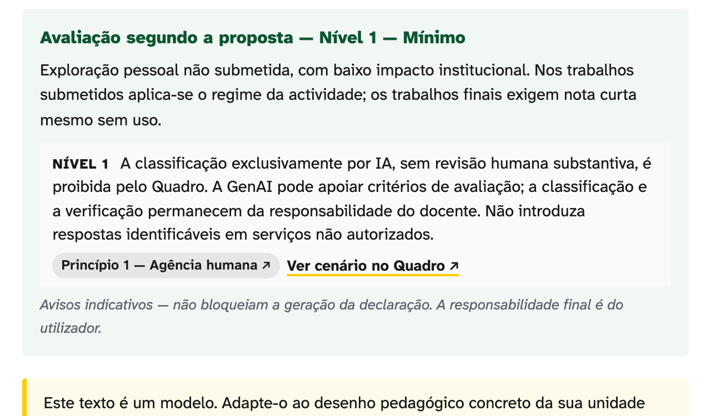

## Cada unidade curricular decide sozinha

::: {.columns}
::: {.column width="42%"}
[14,7 %]{.stat}

::: {.stat-caption}
das 68 instituições de ensino superior inquiridas têm políticas sobre IA em prática (CNIPES, 2026).
:::
:::
::: {.column width="58%"}
::: {.lead}
- Os estudantes recebem sinais diferentes em cada unidade curricular.
- Os docentes decidem sem um critério partilhado.
- O EU AI Act, a Agenda Nacional de IA e o CNE já fixaram prazos e recomendações.
:::
:::
:::

::: {.notes}
Antes de começar (15 s): apresento-me e digo o estado do trabalho. É um contributo individual, não é política da Faculdade.

1 min. O problema é de coerência pedagógica, por isso interessa a este Conselho. O estudante que pergunta o que pode fazer recebe respostas diferentes conforme a UC. Fonte do número: diagnóstico CNIPES, Abril de 2026. Os prazos do AI Act para alto risco são Dezembro de 2027 e Agosto de 2028.
:::

## Três peças, publicadas e gratuitas

::: {.columns}
::: {.column width="33%"}
::: {.card}
<h3>Quadro</h3>

Documento de referência para o uso de IA generativa na FMUP.

Duas partes e doze anexos.
:::
:::
::: {.column width="33%"}
::: {.card}
<h3>Themis</h3>

Ferramenta web que gera declarações de uso e cláusulas para os programas de UC.
:::
:::
::: {.column width="33%"}
::: {.card}
<h3>Formação</h3>

Sessão de 120 minutos para docentes, com seis fichas de actividade.
:::
:::
:::

::: {.notes}
30 s. Tudo em português europeu, licença CC BY 4.0, em tiagojacinto.eu/fmup-ia. Vou explicar o Quadro e a Themis. A formação fica só referida.
:::

## O Quadro compara primeiro e propõe depois

::: {.columns}
::: {.column width="50%"}
::: {.card}
<h3>Parte I: comparação</h3>

- Estados Unidos, Europa e Ibero-América.
- Referenciais supranacionais.
- Enquadramento médico.
- Portugal.
- Lacunas e desafios.
:::
:::
::: {.column width="50%"}
::: {.card}
<h3>Parte II: proposta para a FMUP</h3>

- Sete princípios.
- Três vertentes.
- Processo disciplinar.
- Infraestrutura e governação.
- Implementação, 2026 a 2029.
- Objecções antecipadas.
:::
:::
:::

::: {.small}
Versão 1.7, de 20 de Outubro de 2026. Contributo individual para apreciação dos órgãos da FMUP.
:::

::: {.notes}
1 min. A Parte I compara referenciais externos sem os importar acriticamente. A Parte II é a proposta operacional. O documento é um contributo individual: não é política aprovada e não vincula a Faculdade.
:::

## Sete princípios e três vertentes

::: {.columns}
::: {.column width="45%"}
1. Agência humana
2. Integridade académica e científica
3. Protecção de dados e confidencialidade
4. Transparência
5. Equidade de acesso
6. Literacia crítica
7. Revisão contínua
:::
::: {.column width="55%"}
::: {.card}
<h3>Estudantes</h3>

Declaração por trabalho, com três regimes por actividade.
:::

::: {.card}
<h3>Docentes</h3>

Cláusula-tipo no programa da UC.
:::

::: {.card}
<h3>Investigadores</h3>

Declaração metodológica. A IA não consta como autora.
:::
:::
:::

::: {.notes}
1 min. Os folhetos do Anexo D são para estudantes, docentes, investigadores e serviços. Os sete princípios vêm do ERA Forum, de Chan e da AAMC. As três vertentes tornam os princípios operacionais. O regime em três níveis por actividade alinha com o semáforo da U.Porto: verde, amarelo e vermelho.
:::

## Os anexos são instrumentos prontos a usar

| Anexo | Instrumento |
|:--|:----------------------------------------------|
| A | Modelo de declaração de uso |
| B | Três cláusulas-tipo para UC: permitido, condicionado, proibido |
| D | Guia prático e quatro folhetos em PDF |
| E | Cenários com casos-limite resolvidos |
| I | Seis perfis disciplinares da FMUP |
| J | Promptário clínico, sem dados de doentes |

::: {.small}
Anexos C, F, G, H, K e L: leituras, glossário, maturidade e articulações.
:::

::: {.notes}
45 s. A parte útil no dia-a-dia está nos anexos. O Anexo B resolve a cláusula do programa de uma UC em dez minutos. Se faltar tempo, este slide pode ser saltado.
:::

## Subordina-se à U.Porto e acrescenta a camada biomédica

::: {.columns}
::: {.column width="50%"}
::: {.card}
<h3>Pacote da U.Porto</h3>

Sete documentos de Junho de 2026, para as quinze unidades orgânicas.

Prevalece nas matérias que cobre.
:::
:::
::: {.column width="50%"}
::: {.card}
<h3>Camada FMUP</h3>

- Dados clínicos identificáveis.
- Ensaios clínicos.
- Viés algorítmico em contexto clínico.
- Terminologia médica em português europeu.
:::
:::
:::

::: {.notes}
45 s. A primeira pergunta é sempre a relação com a Universidade. O Anexo H define a regra de precedência. Dois docentes da FMUP, Laura Ribeiro e Ricardo Correia, estão no Grupo de Trabalho da Universidade: a articulação passa por eles.
:::

## A Themis aplica o Quadro a cada papel

::: {.columns}
::: {.column width="33%"}
::: {.card}
<h3>Estudante</h3>

Declaração para acompanhar um trabalho submetido.

Indica as tarefas delegadas à IA e o grau de modificação.
:::
:::
::: {.column width="33%"}
::: {.card}
<h3>Docente</h3>

Cláusula para o programa da UC e requisito de divulgação para os estudantes.

Segue o regime escolhido para a UC.
:::
:::
::: {.column width="33%"}
::: {.card}
<h3>Investigador</h3>

Nota curta para manuscritos e candidaturas.

Declaração de métodos, com o que foi delegado à IA.
:::
:::
:::

::: {.small}
Corre no navegador, sem servidor e sem cookies. Português e inglês. Cada texto indica a versão do Quadro e da ferramenta.
:::

::: {.notes}
1 min. A Themis chama-se assim por Témis, deusa grega da ordem e da lei. Era Atlas até Junho de 2026; mudou de nome para não colidir com o Atlas U.Porto. Versão actual 1.3.2.
:::

## Em quatro passos, a Themis gera a cláusula da UC

::: {.columns}
::: {.column width="50%"}

:::
::: {.column width="50%"}

:::
:::

::: {.small}
Os quatro passos são o tipo de oferta formativa, o trabalho avaliado, a política de IA e as competências a proteger.
:::

::: {.notes}
45 s. Captura real da Themis. Esquerda: as escolhas do docente. Direita: a avaliação de risco e o início do texto para o programa da UC. A ferramenta mostra de onde vem cada aviso, com ligação ao princípio e ao cenário do Quadro.
:::

## A avaliação de risco tem quatro níveis e não bloqueia

::: {.columns}
::: {.column width="25%"}
::: {.card}
<h3>Mínimo</h3>

Nível 1. Exploração pessoal, não submetida.
:::
:::
::: {.column width="25%"}
::: {.card}
<h3>Limitado</h3>

Nível 2. Apoio com supervisão humana. Declaração obrigatória.
:::
:::
::: {.column width="25%"}
::: {.card}
<h3>Alto</h3>

Nível 3. Impacto formativo, clínico ou administrativo. Declaração e registo.
:::
:::
::: {.column width="25%"}
::: {.card}
<h3>Inaceitável</h3>

Nível 4. Uso proibido pelo Quadro.
:::
:::
:::

::: {.small}
Quatro níveis adaptados do modelo HEAT-AI (Temper et al., 2025). Os avisos são indicativos: a ferramenta assinala e explica, e a decisão fica com o utilizador.
:::

::: {.notes}
1 min. A Themis corre as escolhas contra as regras do Quadro e mostra o nível de risco. Nível 1: exploração pessoal, com nota curta nos trabalhos finais. Nível 2: apoio como revisão linguística, com declaração. Nível 3: impacto formativo, clínico ou administrativo, com declaração explícita e registo. Nível 4: dados pessoais em serviços não autorizados, decisão clínica delegada, classificação só por IA, IA como autora. Os avisos não impedem a geração da declaração. A Themis é um demonstrador prototípico, não uma aplicação institucional. Passar a aplicação institucional exige avaliação de segurança, avaliação de impacto sobre a protecção de dados, inscrição no inventário da U.Porto e um responsável técnico.
:::

## Piloto: um ponto focal por departamento

::: {.columns}
::: {.column width="33%"}
::: {.card}
<h3>Passo 1: escolher</h3>

O ponto focal escolhe uma UC do seu departamento.
:::
:::
::: {.column width="33%"}
::: {.card}
<h3>Passo 2: aplicar</h3>

A UC inclui no programa a cláusula gerada pela Themis.
:::
:::
::: {.column width="33%"}
::: {.card}
<h3>Passo 3: verificar</h3>

O ponto focal verifica a implementação e devolve uma ficha curta.
:::
:::
:::

::: {.small}
Piloto de um semestre, com o estatuto de demonstrador comunicado.
:::

::: {.notes}
45 s. Proposta, não pedido: um piloto pequeno, com tarefa definida. Se o Conselho achar útil, cada departamento indica um docente. Palpite de calendário, a confirmar: 2.º semestre de 2026/27. A ficha de devolução ainda não existe: preparo-a quando houver pontos focais.
:::

## Propostas seguintes, até 2029

::: {.columns}
::: {.column width="33%"}
::: {.card}
<h3>Fase 1</h3>

2026 a 2027

- Discussão do Quadro.
- Formação de docentes.
- Piloto num mestrado.
:::
:::
::: {.column width="33%"}
::: {.card}
<h3>Fase 2</h3>

2027 a 2028

- Todos os ciclos de estudo.
- Plataforma IAedu.
- Literacia em IA.
:::
:::
::: {.column width="33%"}
::: {.card}
<h3>Fase 3</h3>

2028 a 2029

- Avaliação de impacto.
- Revisão do Quadro.
- Publicação de resultados.
:::
:::
:::

::: {.small}
Calendário do capítulo Implementação e avaliação, sujeito à evolução da orientação europeia e nacional.
:::

::: {.notes}
45 s. O piloto do slide anterior é o primeiro passo da Fase 1. As fases seguintes dependem da apreciação dos órgãos da FMUP e do que o piloto mostrar. Versão mínima adoptável, se o Quadro completo exigir mais tempo: cláusula nos programas de UC, declaração de uso, proibição de dados pessoais em serviços não autorizados, validação humana na avaliação e formação inicial.
:::

# Perguntas e contributos {.center .fmup-dark background-color="#1A1A1A"}

::: {.columns}
::: {.column width="62%"}
Quadro, Themis e materiais:

[tiagojacinto.eu/fmup-ia](https://tiagojacinto.eu/fmup-ia/)
:::
::: {.column width="38%"}

:::
:::

::: {.notes}
15 s. O QR code abre o site com o Quadro, a Themis e os guias.

Tempo total previsto: cerca de 10 minutos. Se faltar tempo, saltar os slides dos anexos e do calendário.
:::
